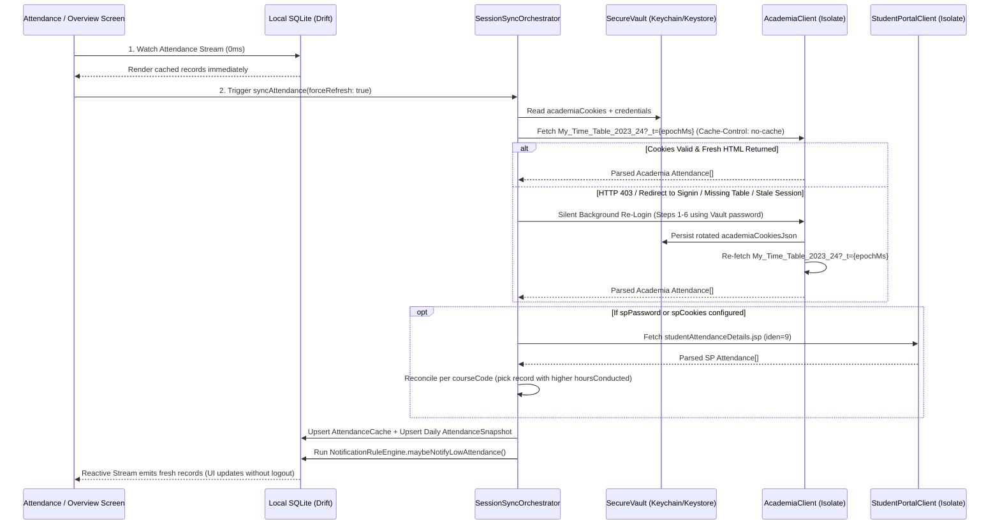

# architecture.md — SRMOne 100% Local-First Flutter Mobile Architecture (iOS & Android)

## 1. Executive Architecture Overview

`SRMOne Mobile` transitions the multi-service web architecture (React 18 + Vite + Express 5 + Go Scrapers + Python OCR + Cloudflare Relay + Supabase PostgreSQL) into a **100% Local-First, Zero-Server Native Application** built with **Flutter (Dart)** targeting **iOS (iPhone)** and **Android**.

### Why 100% Local-First Works Better on Mobile
1. **Zero Server & Database Cost ($0/month):** Eliminates Render, Vercel, and Supabase hosting costs and removes the legacy `MAX_USERS = 8` in-memory session bottleneck in `server.js`.
2. **Zero IP Blocking (No Cloudflare Relay Needed by Default):** Legacy backend servers (Render/AWS) were blocked by `sp.srmist.edu.in` because requests originated from foreign datacenter IP ranges. On mobile, requests originate directly from each student's residential/cellular Indian ISP (`Jio`, `Airtel`, `Vi`, or `SRM Campus Wi-Fi`), bypassing datacenter IP blocks naturally.
3. **Sub-3ms Offline Startup:** Cached profile, attendance, marks, timetable, and calendar data load instantaneously from on-device SQLite (`Drift`) before network validation completes.
4. **Hardware-Backed Credential Privacy:** Student NetID, Academia password, Student Portal password, and serialized session cookies never leave the student's phone; they are encrypted inside **iOS Keychain (Secure Enclave)** and **Android Keystore** via `flutter_secure_storage`.

---

## 2. High-Level System Topology

```mermaid
flowchart TB
    subgraph Phone["Student Device (iPhone iOS / Android)"]
        UI["Flutter UI Layer
(Screens, Bottom Sheets, Charts, Widgets)"]
        AuthLock["Biometric Guard
(local_auth: FaceID / TouchID / Fingerprint)"]
        State["Riverpod 2.x State & Sync Controllers
(Stale-While-Revalidate + Auto-Refresh)"]
        Domain["Pure Dart Domain Layer
(CalendarDayResolver, ScheduleBuilder,
AttendancePlannerMath, NotificationEngine)"]
        
        subgraph Storage["On-Device Persistence"]
            Vault["Hardware Secure Vault
(flutter_secure_storage: Keychain / Keystore)
- netId / email
- academiaPassword / spPassword
- academiaCookiesJson / spCookiesJson"]
            DB["Local SQLite Database (Drift)
- student_profiles
- attendance_snapshots
- user_settings
- notification_settings
- notifications
- timetable_cache / marks_cache
- calendar_cache / faculty_cache"]
        end

        subgraph IsolatePool["Background Dart Isolates & OCR"]
            AcadAdapter["Academia Scraper Adapter
(Dio + SimpleCookieJar + Zoho Unwrapper)"]
            SpAdapter["Student Portal Adapter
(Dio + SimpleCookieJar + Trap/Telemetry Builder)"]
            FacAdapter["Faculty Directory Scraper
(WordPress Search + Elementor Parser)"]
            OCR["Local CAPTCHA Engine
(ddddocr common.onnx via onnxruntime
+ Manual BottomSheet Fallback)"]
        end

        BG["Background Task Scheduler
(workmanager: BGAppRefreshTask / WorkManager)
+ flutter_local_notifications"]
    end

    subgraph Upstream["SRM Upstream Portals (Direct HTTPS)"]
        Zoho["SRM Academia Portal
https://academia.srmist.edu.in"]
        SP["SRM Student Portal
https://sp.srmist.edu.in"]
        FacWeb["SRM Main Website
https://www.srmist.edu.in/?s=...&post_type=faculty"]
    end

    UI --> AuthLock --> State
    State <--> Domain
    State <--> DB
    State <--> Vault
    State --> IsolatePool
    BG --> IsolatePool
    BG --> Domain
    BG --> DB
    SpAdapter <--> OCR
    AcadAdapter -->|Direct HTTPS + Cache-Busting| Zoho
    SpAdapter -->|Direct HTTPS (Optional Relay Fallback)| SP
    FacAdapter -->|Direct HTTPS| FacWeb
```

---

## 3. Core Technology Stack Mapping (Web/Go → Flutter)

| Legacy Layer | Legacy Technology | Target Flutter Package | Architectural Role |
|---|---|---|---|
| **Frontend Framework** | React 18 + Vite 5 | **Flutter 3.24+ (Dart 3.5+)** | Impeller 60/120fps native rendering on iOS & Android |
| **Routing** | `react-router-dom` (`HashRouter`) | **`go_router`** | Auth guard, biometric lock gate, and stateful bottom navigation shell |
| **State Management** | React `useState` / Custom Hooks | **`flutter_riverpod` + `riverpod_annotation`** | Reactive providers, Stale-While-Revalidate sync, SQLite stream binding |
| **HTTP & Scraping** | Go `valyala/fasthttp` + Node `axios` | **`dio`** + Custom `SimpleCookieJar` | Manual redirect loop (`maxRedirects: 10`), non-strict cookie jar, custom headers |
| **HTML DOM Parsing** | Go `PuerkitoBio/goquery` | **`html` (`package:html/parser.dart`)** | CSS selector querying (`querySelectorAll`, `querySelector`) inside Dart Isolates |
| **CAPTCHA OCR** | Python `ddddocr` (`solve_captcha.py`) | **`onnxruntime`** (bundled `common.onnx`) | Runs the exact `ddddocr` CRNN/CTC ONNX model offline in <15ms + manual fallback |
| **Database** | Supabase PostgreSQL (11 tables) | **`drift` + `sqlite3_flutter_libs`** | Reactive local SQLite database with type-safe queries and streams |
| **Credential Crypto** | Node `crypto.js` (`aes-256-cbc` + DB) | **`flutter_secure_storage`** | iOS Keychain (`kSecAttrAccessibleAfterFirstUnlock`) & Android EncryptedSharedPreferences/Keystore |
| **Biometric Security** | *None* | **`local_auth`** | Optional FaceID / TouchID / Fingerprint app lock |
| **Charts** | `recharts` | **`fl_chart`** | 30-day attendance trend line chart with 75% reference line & interactive tooltips |
| **Animations** | `framer-motion` + `animejs` | **`flutter_animate`** | Declarative entrance animations, shimmer skeletons, and accordion transitions |
| **Icons & SVGs** | `lucide-react` + inline `/assets/*.svg` | **`lucide_icons_flutter` + `flutter_svg`** | Renders Lucide icons and the 13 pruned local SVG illustrations |
| **Timetable Image Export**| `html2canvas` | **`screenshot` + `share_plus` + `gal`** | Captures offscreen high-DPI Flutter widget tree to PNG and opens native iOS/Android share sheet |
| **Background Sync** | Server warm-up interval | **`workmanager` + `flutter_local_notifications`** | Periodic background attendance/calendar sync and native lock-screen notifications |
| **Post-Core Native Extras**| *None* | **`home_widget` + `device_calendar`** | iOS WidgetKit / Android AppWidget & 1-Tap Apple/Google Calendar sync |

---

## 4. Target Directory Structure (`srmone_mobile/`)

The coding agent must initialize the Flutter project at `SRMOne/srmone_mobile/` with the following clean modular structure:

```text
SRMOne/
├── AGENTS.md
├── architecture.md
├── plan.md
├── SCRAPER_SPEC.md
├── IOS_BUILD_GUIDE.md
├── academia-backend/                  # [READ-ONLY REFERENCE] Legacy Node + Go + React repo
└── srmone_mobile/                     # [NEW FLUTTER APPLICATION]
    ├── pubspec.yaml
    ├── analysis_options.yaml
    ├── assets/
    │   ├── images/
    │   │   └── logo.png               # Copied from academia-backend/frontend/public/assets/logo.png
    │   ├── illustrations/             # ONLY the 13 actively used SVGs (pruned from 3,447)
    │   │   ├── a-day-off_uk4x.svg
    │   │   ├── calendar_8r6s.svg
    │   │   ├── chilling_o2zv.svg
    │   │   ├── coffee-time_98vi.svg
    │   │   ├── events-calendar_sudy.svg
    │   │   ├── learning_qt7d.svg
    │   │   ├── online-learning.svg
    │   │   ├── studying.svg
    │   │   ├── success_288d.svg
    │   │   ├── target_d6hf.svg
    │   │   ├── time-management_4ss6.svg
    │   │   ├── travel-plans_l0fo.svg
    │   │   └── vacation-selfie_q5bs.svg
    │   └── ml/
    │       ├── ddddocr_common.onnx    # Extracted ddddocr ONNX model (~6 MB)
    │       └── ddddocr_charset.json   # Vocabulary array for CTC decoding
    ├── ios/                           # Xcode workspace, Info.plist (FaceID, BGTaskSchedulerPermittedIdentifiers)
    ├── android/                       # Gradle config, AndroidManifest.xml (USE_BIOMETRIC, WorkManager)
    ├── lib/
    │   ├── main.dart                  # App bootstrap, Drift init, WorkManager registration, ProviderScope
    │   ├── app.dart                   # MaterialApp.router, light/dark theme, BiometricLockGate
    │   ├── core/
    │   │   ├── constants/
    │   │   │   ├── portal_endpoints.dart
    │   │   │   └── asset_paths.dart
    │   │   ├── network/
    │   │   │   ├── simple_cookie_jar.dart       # Exact port of Go custom CookieJar
    │   │   │   ├── manual_redirect_client.dart  # 10-hop manual redirect follower (301/302/303 -> GET)
    │   │   │   └── cache_buster_interceptor.dart
    │   │   ├── security/
    │   │   │   ├── secure_vault_service.dart    # flutter_secure_storage wrapper
    │   │   │   └── biometric_auth_service.dart  # local_auth FaceID/Fingerprint wrapper
    │   │   └── database/
    │   │       ├── app_database.dart            # Drift SQLite tables & DAOs
    │   │       └── app_database.g.dart
    │   ├── scrapers/
    │   │   ├── academia/
    │   │   │   ├── academia_client.dart         # 6-step Zoho login + continuation unblocker
    │   │   │   ├── academia_decoder.dart        # pageSanitizer byte-scanner + [zmlvalue] unescaper
    │   │   │   └── academia_parsers.dart        # Profile, Attendance, Marks, Timetable, Calendar parsers
    │   │   ├── student_portal/
    │   │   │   ├── sp_client.dart               # SECURE_CONFIG + X-Domain-Proof + Trap/Telemetry POST
    │   │   │   ├── sp_captcha_solver.dart       # ONNX ddddocr inference + manual fallback trigger
    │   │   │   └── sp_parsers.dart              # Permissive Attendance, Profile, Internal Marks (iden=9/13)
    │   │   └── faculty/
    │   │       ├── faculty_client.dart          # WordPress search + profile fetcher
    │   │       └── faculty_parser.dart          # Elementor & featuredImage regex parser
    │   ├── domain/
    │   │   ├── models/                          # Freezed / JSON-serializable immutable DTOs
    │   │   │   ├── student_profile.dart
    │   │   │   ├── attendance_record.dart
    │   │   │   ├── marks_record.dart
    │   │   │   ├── timetable_data.dart
    │   │   │   ├── calendar_data.dart
    │   │   │   ├── faculty_profile.dart
    │   │   │   ├── app_notification.dart
    │   │   │   └── user_settings.dart
    │   │   └── services/
    │   │       ├── session_sync_orchestrator.dart # 4-Layer Zero-Logout Refresh Engine
    │   │       ├── calendar_day_resolver.dart     # Unified calendarTimetableSync + schedule_utils
    │   │       ├── attendance_planner_math.dart   # Exact Reach Target & Plan Holiday formulas
    │   │       ├── current_class_detector.dart    # Clock-based current/upcoming class highlighter
    │   │       ├── notification_rule_engine.dart  # maybeNotifyLowAttendance + welcome + holiday_alert
    │   │       └── timetable_image_exporter.dart  # Native offscreen canvas PNG generator
    │   ├── background/
    │   │   └── background_sync_worker.dart      # WorkManager isolate entrypoint
    │   └── features/
    │       ├── auth/
    │       │   ├── login_screen.dart
    │       │   ├── sp_captcha_bottom_sheet.dart
    │       │   └── biometric_lock_screen.dart
    │       ├── shell/
    │       │   └── dashboard_shell_screen.dart  # Bottom Navigation + AppBar + NotificationBell + Profile Sheet
    │       ├── overview/
    │       │   └── overview_screen.dart
    │       ├── attendance/
    │       │   ├── attendance_screen.dart
    │       │   └── widgets/
    │       │       ├── attendance_planner_card.dart
    │       │       └── attendance_trend_chart.dart
    │       ├── timetable/
    │       │   ├── timetable_screen.dart
    │       │   └── widgets/
    │       │       └── exportable_timetable_poster.dart
    │       ├── marks/
    │       │   └── marks_screen.dart
    │       ├── calendar/
    │       │   └── calendar_screen.dart
    │       ├── faculty/
    │       │   ├── faculty_avatar.dart
    │       │   └── faculty_profile_sheet.dart
    │       ├── notifications/
    │       │   └── notification_bell_sheet.dart
    │       ├── settings/
    │       │   ├── settings_screen.dart
    │       │   └── legal_markdown_screen.dart
    │       └── widgets_and_calendar_sync/       # Phase 6 Post-Core Native Features
    │           ├── home_widget_sync.dart
    │           └── native_calendar_exporter.dart
    └── test/
        ├── fixtures/                            # Sanitized JSON & HTML test fixtures
        ├── scrapers/                            # Parser & decoder unit tests
        └── domain/                              # Planner math, calendar resolver, notification rule tests
```

---

## 5. The 4-Layer "Zero-Logout" Attendance Auto-Refresh Architecture

In the legacy system, attendance failed to update until the user logged out and logged back in because:
1. `server.js` cached `sessions[email].cache.attendance` in memory for 30 minutes (resetting TTL on every access) and only cleared it on `POST /api/logout`.
2. Zoho Creator (`My_Time_Table_2023_24`) serves stale server-cached fragments if queried without cache-busting parameters or when a Zoho sub-session silently goes stale.

### How `SessionSyncOrchestrator` Solves This Permanently



#### Layer 1: Stale-While-Revalidate (SWR) Reactive Streams
Every screen watches a `Drift` SQLite stream (`watchAttendanceRecords()`). Cached data paints on frame 1 (`<3ms`). Simultaneously, `syncAttendance()` triggers in the background on app launch, foreground resume (if last sync `> 5 minutes` ago), and manual pull-to-refresh.

#### Layer 2: Zoho & OS Cache-Busting Headers
Every live GET request to `My_Time_Table_2023_24` and `Academic_Reports` appends `?_t=${DateTime.now().millisecondsSinceEpoch}` and sets:
```http
Cache-Control: no-cache, no-store, must-revalidate
Pragma: no-cache
Expires: 0
X-Requested-With: XMLHttpRequest
Referer: https://academia.srmist.edu.in/
```

#### Layer 3: Transparent Silent Session Rotation (Auto-Reauth)
If `fetchDecodedFragment()` fails to locate a table with header `Attn %`, receives HTTP `401`/`403`, or lands on a Zoho `/signin` or `/sessions-reminder` URL:
1. `SessionSyncOrchestrator` catches `SessionExpiredException`.
2. It reads `academia_email` and `academia_password` from `flutter_secure_storage`.
3. It runs a fresh 6-step `AcademiaClient.login()` in the background isolate, automatically clearing any Zoho `block-sessions` or `daily sign-in limit` pages.
4. It overwrites `academia_cookies_json` in `flutter_secure_storage` and retries the attendance fetch.
5. **Force Deep Sync Action:** Pulling down and holding on the Attendance screen (or tapping the "Deep Sync" icon in the top bar) forces a fresh cookie rotation even if the existing cookie jar appears valid, guaranteeing a clean server snapshot from Zoho in ~1.5 seconds without logging out.

#### Layer 4: Dual-Source Reconciliation (Academia + Student Portal)
When both Academia and Student Portal sessions are available, `SessionSyncOrchestrator` compares each course by normalized `courseCode`:
- If Student Portal reports `hoursConducted > academia.hoursConducted` (meaning faculty updated attendance on SP before Zoho synced), the orchestrator surfaces the newer counts and marks `source: 'student_portal_newer'`.

---

## 6. On-Device Storage Architecture

### 6.1 Hardware Secure Vault (`flutter_secure_storage`)
Replaces `academia_credentials`, `academia_sessions`, and `crypto.js`.
- **iOS Configuration:** `IOSOptions(accessibility: KeychainAccessibility.first_unlock_this_device)` (allows background `workmanager` refreshes while the phone is locked after first boot unlock).
- **Android Configuration:** `AndroidOptions(encryptedSharedPreferences: true)`.

| Vault Key | Value Type | Purpose |
|---|---|---|
| `vault.academia_email` | `String` (`...@srmist.edu.in`) | Active authenticated user identifier |
| `vault.academia_password` | `String` | Used for silent background cookie rotation |
| `vault.sp_password` | `String?` | Optional Student Portal password |
| `vault.academia_cookies_json` | `String` (JSON map) | Serialized `SimpleCookieJar` for `academia.srmist.edu.in` |
| `vault.academia_saved_at` | `String` (ISO-8601) | Timestamp of last cookie refresh |
| `vault.sp_cookies_json` | `String?` (JSON map) | Serialized `SimpleCookieJar` for `sp.srmist.edu.in` |
| `vault.biometric_lock_enabled`| `String` (`"true"` / `"false"`) | Controls FaceID / Fingerprint prompt on app launch |

### 6.2 Local SQLite Schema (`Drift` — `app_database.dart`)
Replaces all 11 Supabase PostgreSQL tables (7 migration tables + 4 runtime cache tables) with 100% local SQLite tables:

1. **`StudentProfiles`** (replaces `public.student_profiles`):
   - `academiaEmail` (`TEXT PRIMARY KEY`), `name`, `regNumber`, `photoUrl` (stores Base64 data URL or local cached file path), `cgpa` (`REAL`), `branch`, `section`, `semester`, `batch`, `phone`, `email`, `parentEmail`, `parentPhone`, `mentor`, `program`, `campus`, `rawDataJson` (`TEXT`), `cachedAt` (`INTEGER`).
2. **`AttendanceCache`** (new explicit local table replacing in-memory `sessions[email].cache.attendance`):
   - `academiaEmail` (`TEXT`), `courseCode` (`TEXT`), `courseTitle` (`TEXT`), `category` (`TEXT`), `facultyName` (`TEXT`), `slot` (`TEXT`), `roomNo` (`TEXT`), `hoursConducted` (`INTEGER`), `hoursAbsent` (`INTEGER`), `attendancePct` (`REAL`), `source` (`TEXT`), `updatedAt` (`INTEGER`). Primary Key: `(academiaEmail, courseCode, category)`.
3. **`AttendanceSnapshots`** (replaces `public.attendance_snapshots`):
   - `id` (`INTEGER PRIMARY KEY AUTOINCREMENT`), `academiaEmail` (`TEXT`), `snapshotDate` (`TEXT` formatted `YYYY-MM-DD`), `overallPercentage` (`REAL` — unweighted arithmetic mean for backward compatibility), `weightedPercentage` (`REAL`), `subjectsJson` (`TEXT`), `totalClasses` (`INTEGER`), `attendedClasses` (`INTEGER`), `createdAt` (`INTEGER`). Unique constraint on `(academiaEmail, snapshotDate)`.
4. **`TimetableCache`** (replaces `timetable_cache`):
   - `academiaEmail` (`TEXT PRIMARY KEY`), `batch` (`TEXT`), `coursesJson` (`TEXT`), `advisorsJson` (`TEXT`), `updatedAt` (`INTEGER`).
5. **`MarksCache`** (replaces `marks_cache`):
   - `academiaEmail` (`TEXT`), `courseCode` (`TEXT`), `courseTitle` (`TEXT`), `courseType` (`TEXT`), `source` (`TEXT` — `'academia'` or `'student_portal'`), `testsJson` (`TEXT`), `updatedAt` (`INTEGER`). Primary Key: `(academiaEmail, courseCode, source)`.
6. **`CalendarCache`** (replaces `calendar_cache`):
   - `academiaEmail` (`TEXT`), `semester` (`TEXT` — `'odd'` or `'even'`), `title` (`TEXT`), `monthsJson` (`TEXT`), `updatedAt` (`INTEGER`). Primary Key: `(academiaEmail, semester)`.
7. **`FacultyCache`** (replaces `faculty_cache`):
   - `slug` (`TEXT PRIMARY KEY`), `name` (`TEXT`), `photoUrl` (`TEXT`), `designation` (`TEXT`), `department` (`TEXT`), `email` (`TEXT`), `campus` (`TEXT`), `experience` (`TEXT`), `researchInterest` (`TEXT`), `courses` (`TEXT`), `education` (`TEXT`), `publications` (`TEXT`), `awards` (`TEXT`), `workshops` (`TEXT`), `workExperience` (`TEXT`), `memberships` (`TEXT`), `responsibilities` (`TEXT`), `profileUrl` (`TEXT`), `cachedAt` (`INTEGER`).
8. **`UserSettingsTable`** (replaces `public.user_settings`):
   - `academiaEmail` (`TEXT PRIMARY KEY`), `theme` (`TEXT DEFAULT 'light'`), `defaultView` (`TEXT DEFAULT 'overview'`), `attendanceThreshold` (`REAL DEFAULT 75.0`), `calendarView` (`TEXT DEFAULT 'month'`), `timetableView` (`TEXT DEFAULT 'week'`), `showWeekends` (`INTEGER DEFAULT 1`), `biometricLockEnabled` (`INTEGER DEFAULT 0`), `customSpRelayUrl` (`TEXT NULL`), `dashboardWidgetsJson` (`TEXT DEFAULT '[]'`), `customDataJson` (`TEXT DEFAULT '{}'`), `updatedAt` (`INTEGER`).
9. **`NotificationSettingsTable`** (replaces `public.notification_settings`):
   - `academiaEmail` (`TEXT PRIMARY KEY`), `attendanceAlertEnabled` (`INTEGER DEFAULT 1`), `attendanceThreshold` (`REAL DEFAULT 75.0`), `holidayAlertsEnabled` (`INTEGER DEFAULT 1`), `pushEnabled` (`INTEGER DEFAULT 1`), `updatedAt` (`INTEGER`).
10. **`NotificationsTable`** (replaces `public.notifications`):
    - `id` (`TEXT PRIMARY KEY` UUID), `academiaEmail` (`TEXT`), `type` (`TEXT` — `'low_attendance'`, `'welcome'`, `'holiday_alert'`, `'test'`), `title` (`TEXT`), `body` (`TEXT`), `dataJson` (`TEXT`), `read` (`INTEGER DEFAULT 0`), `createdAt` (`INTEGER`).

---

## 7. On-Device CAPTCHA Architecture (`solve_captcha.py` Replacement)

The legacy Student Portal scraper executed `python3 solve_captcha.py <image_path>`, which ran `ddddocr.DdddOcr(show_ad=False).classification(image_bytes)`.

### Mobile Port (`sp_captcha_solver.dart`)
1. **Model Extraction (Build Setup Step):**
   - Extract `common.onnx` (or `common_old.onnx`) and its character vocabulary array from the Python `ddddocr` package once during project setup and place them in `srmone_mobile/assets/ml/ddddocr_common.onnx` and `ddddocr_charset.json`.
2. **Inference Pipeline on Dart Isolate:**
   - Decode the CAPTCHA image bytes (`image` package).
   - Resize image so height = `64px` while preserving aspect ratio (`width = (origWidth * (64 / origHeight)).round()`), convert to single-channel grayscale float tensor normalized to `[-1.0, 1.0]` (`(pixel / 255.0 - 0.5) / 0.5`), shape `[1, 1, 64, width]`.
   - Run `OrtSession.run()` via `onnxruntime`.
   - Perform CTC ArgMax + collapse repeated adjacent tokens and remove blank token (`index 0`) to produce the predicted string.
3. **Automatic Manual Fallback Modal (`sp_captcha_bottom_sheet.dart`):**
   - If ONNX inference throws an error, or if `LoginServlet` responds with `div.alert-danger` indicating an invalid CAPTCHA after 2 automated retries, `SpClient` returns `SpLoginResult.captchaRequired(imageBytes, sessionContext)`.
   - The UI immediately presents `SpCaptchaBottomSheet` displaying the live `img#secure_captcha` image, a refresh button (`spRefreshCaptcha`), and a text input so the student can type the 5–6 characters manually.